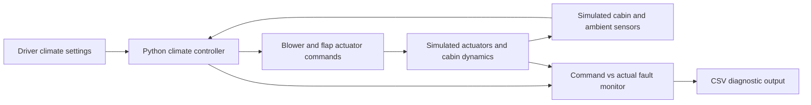

# Rapid Climate Control Prototyping — Python Simulator

**An independent, educational simulation of automotive cabin climate control and actuator diagnostics.**

This portfolio demonstration reflects the engineering themes of rapid control prototyping: simulated sensor acquisition, blower and air flap commands, cabin-temperature response, signal logging, and fault investigation.

> **Important:** All code, numerical parameters and measurements are original and synthetic. This project is **not** Mercedes-Benz code, a dSPACE or Simulink export, a production ECU, or a real LIN/CAN implementation. It contains no proprietary calibrations, recordings or internal control logic. It must not be used to control physical equipment.

## What it demonstrates

- **Climate controller:** A simple feedforward and proportional method calculates a temperature-blend flap request.
- **Sensors:** Noisy simulated cabin and ambient temperature readings.
- **Actuators:** Bounded-rate blower, blend flap, face/feet/defrost distribution flaps.
- **Driver requests:** Cabin temperature, fan setting and outlet distribution change during the example drive.
- **Diagnostics:** A simulated stuck blend flap and command-versus-actual mismatch monitoring.
- **Validation:** Reproducible time series, CSV export and unit tests.

## Architecture



## Quick start

Python **3.10+**. The simulator and unit tests use the standard library. Plotting is optional.

```bash
python -m pip install -e .
python -m unittest discover -s tests -v

# Normal operation: create a time-series CSV
python -m rcp_hvac.cli --output outputs/normal.csv

# Optional plots (requires matplotlib)
python -m pip install -e ".[plot]"
python -m rcp_hvac.cli --output outputs/normal.csv --plot outputs/normal.png

# Inject a simulated stuck temperature-blend flap
python -m rcp_hvac.cli --stuck-blend --fault-at 190 \
  --output outputs/stuck_blend.csv --plot outputs/stuck_blend.png
```

## Example scenario

| Elapsed time | Target cabin temperature | Fan request | Outlet |
|---|---|---|---|
| 0–119 s | 21°C | 50% | Face |
| 120–239 s | 24°C | 60% | Feet |
| 240 s onward | 18°C | 70% | Defrost |

The fault demonstration freezes the blend flap at 190 seconds. Subsequent demand changes may lead to a sustained difference between the commanded and simulated actual flap positions. The mismatch detector is deliberately simple and is **not** a production diagnostic algorithm.

### Example CSV signals

`time_s`, `cabin_sensor_c`, `cabin_actual_c`, `ambient_sensor_c`, `target_cabin_c`, `distribution`, `blower_command_pct`, `blower_actual_pct`, `blend_command_pct`, `blend_actual_pct`, `fault_active`, `blend_mismatch_flag`.

## Repository structure

```text
rcp_hvac/
    models.py        Typed sensor, request and actuator structures
    controller.py    Simplified original cabin controller
    simulator.py     Synthetic vehicle, actuator dynamics and faults
    cli.py           CSV export and optional plots
tests/
    test_controller.py
    test_simulator.py
.github/workflows/tests.yml
pyproject.toml
requirements.txt
LICENSE
README.md
```

## How to describe it in an interview

> I created an independent Python demonstration of automotive climate-control rapid prototyping. It models simulated cabin sensors, blower and distribution flaps, changing driver requests and a stuck-flap diagnosis. The CSV traces make it possible to investigate the difference between requested and actual actuator behavior. It illustrates the engineering skills I developed in climate-control prototyping, without using company software or vehicle data.

## Limitations and next steps

The physics and actuators are simplified. This is not real-time embedded code and has no actual LIN/CAN bus, microcontroller, compressor/refrigerant model, hardware timing guarantees, or production safety/diagnostics. Potential extensions include simulated LIN communication, sensor dropouts, richer fault handling, a dashboard, and independent test scenarios.

MIT licensed; see [LICENSE](LICENSE).
