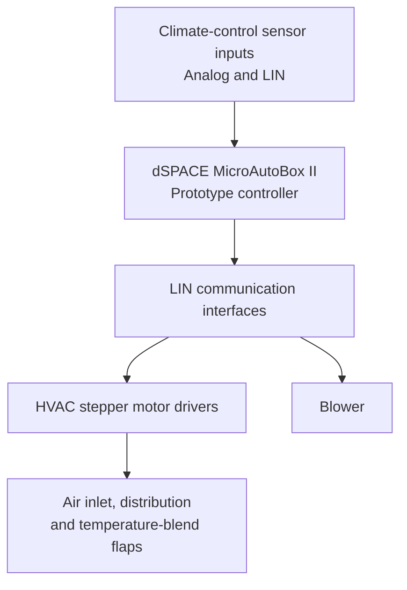
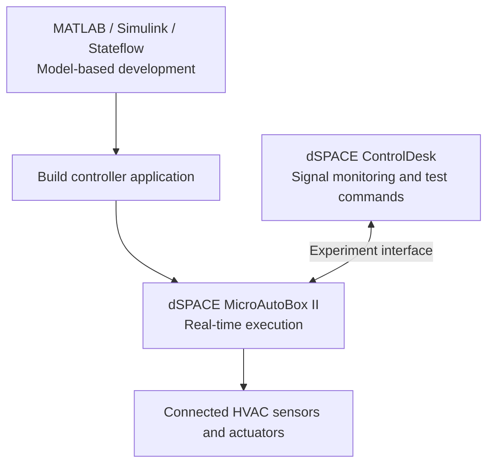

# Rapid Prototyping for Climate Control Development

## Project Overview

This project focused on developing a **Rapid Control Prototyping (RCP)** system for climate control in an electric vehicle. The objective was to integrate hardware and software components, develop a functional climate-control prototype, and test its behavior before deployment on a production electronic control unit (ECU).

## System Development

A **dSPACE MicroAutoBox II** was used as a real-time prototype controller. The system integrated climate-control sensors and actuators, including stepper motors for HVAC air-distribution and temperature flaps, and the blower.

**MATLAB/Simulink** and **Stateflow** were used for model-based software development. **LIN (Local Interconnect Network)** supported communication with relevant sensors and actuators, and **dSPACE ControlDesk** was used to monitor signals, adjust parameters, and conduct real-time experiments.

## System Architecture

The prototype combined a real-time controller with climate-control sensors and actuators. The following diagram illustrates the main components at a general level; it is **not an original hardware schematic** or a reproduction of the vehicle wiring.

The controller executes prototype control functions, processes sensor inputs, and communicates with HVAC components. Actuator commands can then be monitored and checked during testing.

## Project Work

- Worked on hardware–software integration of climate-control components with the prototype ECU.
- Developed and configured Simulink models for control and LIN communication.
- Integrated stepper-driver functions and actuator operating modes.
- Used ControlDesk to test stepper movement, requested positions, blower operation, and communication behavior.
- Used Git and Jira to support collaborative development and issue tracking.

## Development Workflow

The control software was developed with MATLAB/Simulink and Stateflow, built for real-time execution on the MicroAutoBox II, and observed during experiments using dSPACE ControlDesk.

The diagrams summarize the development workflow only. They do not include company-specific software architecture, LIN Description Files, settings, or communication frames.

## Testing and Validation

The prototype was evaluated through component-level tests using ControlDesk. The documented test work included:

- **Stepper motor response:** Applied position requests and checked how the flap actuators responded.
- **Blower operation:** Monitored and adjusted blower commands during prototype testing.
- **LIN communication:** Observed communication behavior while integrating and troubleshooting the connected components.

The report documents functioning stepper-driver and blower demonstrations. **Complete sensor testing was still pending** at the end of the documented internship work.

## Technical Skills

| Area | Tools and Technologies |
| --- | --- |
| Model-based development | MATLAB, Simulink, Stateflow |
| Rapid control prototyping | dSPACE MicroAutoBox II |
| Vehicle communication | LIN |
| Testing and monitoring | dSPACE ControlDesk, functional testing |
| Development workflow | Git, Jira |

## Results and Conclusion

The internship resulted in a functioning **hardware–software prototyping setup** for developing and testing EV climate-control functions. Testing demonstrated the operation of stepper drivers and the blower through the prototype environment.

This project strengthened my experience in automotive embedded systems, model-based development, LIN communication, real-time prototyping, integration, and functional testing.

## Project Documentation

This repository presents a concise overview of the internship work. The original company software, Simulink models, LIN configuration files, measurement data, and internal system diagrams are not published here.
